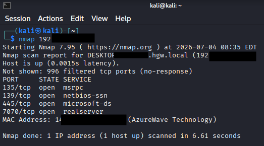
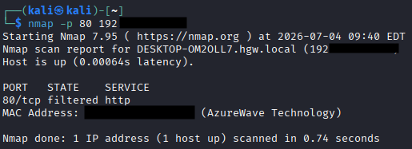
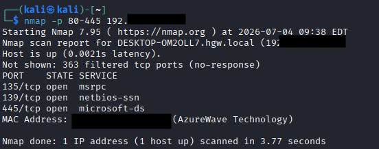
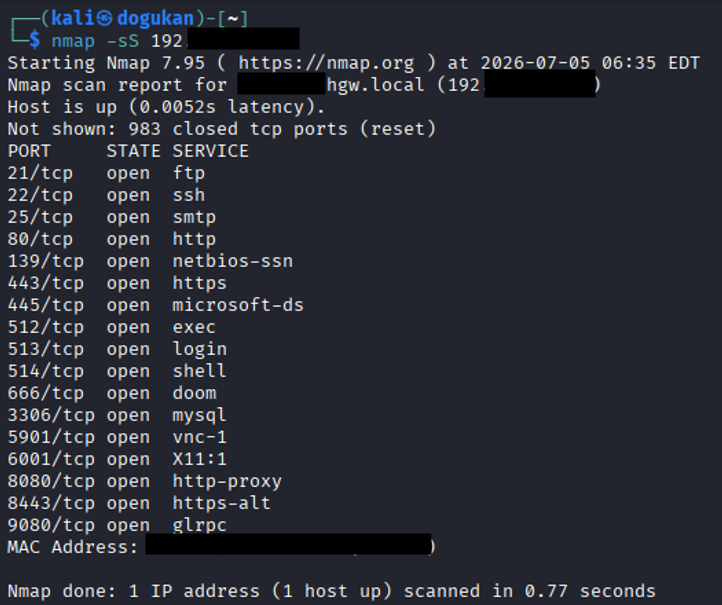
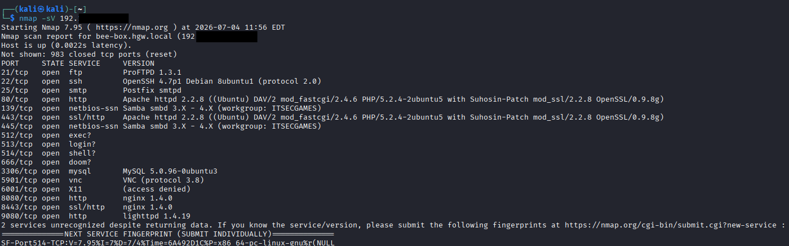

## Nmap nedir?

Nmap, ağ tarama ve keşif işlemleri için kullanılan açık kaynaklı bir araç. Ağdaki cihazları ve açık portları taramak, servisleri belirlemek ve hatta hedef sistemlerin işletim sistemini tanımlamak için kullanılır. Bir pentest'in neredeyse her zaman ilk adımı budur.

## Kali içinde kurulum

Kullandığımız Kali Linux'ta Nmap genellikle varsayılan olarak yüklü ve kullanıma hazır gelir. Kontrol etmek için:

```bash
nmap --version
```

Çıktı buna benziyorsa Nmap kuruludur:

```
Nmap version 7.xx ( https://nmap.org )
```

Ama şöyle bir çıktı alıyorsanız:

```
nmap: command not found
```

Nmap kurulu değildir. Bu durumda şu komutla kurabilirsiniz:

```bash
sudo apt update && sudo apt install nmap
```

Kurduktan sonra tekrar `nmap --version` ile kontrol edip kullanmaya başlayabilirsiniz.

## Standart tarama

Terminali açıp hedef IP'yi vererek Nmap'i başlatabiliriz:

```bash
nmap <taranacak-ip>
```



Bu şekilde bir tarama başlattığınızda Nmap varsayılan olarak en yaygın **1000 portu** tarar ve açık olanları gösterir.

## -p: Belirli port(lar)ı taramak

Yalnızca belirli bir portu ya da portları taramak isterseniz:

```bash
nmap -p <port/portlar> <taranacak-ip>
```



Böylece yalnızca istediğiniz açık port(lar)ı görürsünüz. Bir **port aralığı** taramak için:

```bash
nmap -p <xx-xx> <taranacak-ip>
```



Bu şekilde seçtiğiniz aralıktaki açık portları görebilirsiniz.

## -sS: Hızlı ve sessiz tarama

`-sS` (SYN taraması) hem hızlı hem de ağda daha az trafik yaratan bir parametre. Bu sayede hem daha hızlı tarama yapar, hem de ağda daha az iz bırakarak daha az dikkat çekersiniz.

```bash
sudo nmap -sS <taranacak-ip>
```



Çok kısa sürede ve az ağ trafiğiyle tarama yapabilirsiniz.

## -sV: Servis ve sürüm tespiti

`-sV` parametresi size yalnızca açık portları değil, aynı zamanda o portun üzerinde çalışan **uygulamaları ve sürümlerini** gösterir.

```bash
nmap -sV <taranacak-ip>
```



Tek başına `-sV` kullanıldığında işlem uzun sürebilir; bu durumlarda `-sS` ile birlikte kullanıp daha hızlı tarama başlatabilirsiniz:

```bash
sudo nmap -sS -sV <taranacak-ip>
```

`-sV`'nin asıl kullanım amacı, portlarda çalışan uygulamaların sürümlerini görüp bilinen bir açıklarının olup olmadığını kontrol etmektir.

## Özet

| Parametre | Ne yapar |
|---|---|
| `nmap <ip>` | En yaygın 1000 portu tarar |
| `-p <port>` | Belirli port(lar)ı / aralığı tarar |
| `-sS` | Hızlı, az iz bırakan SYN taraması |
| `-sV` | Servis ve sürüm tespiti |

Bu dört parametre, bir keşfin büyük kısmını karşılar. Sürüm bilgisini aldıktan sonraki adım, çıkan uygulama ve sürümlerin bilinen açıklarını araştırmaktır.
